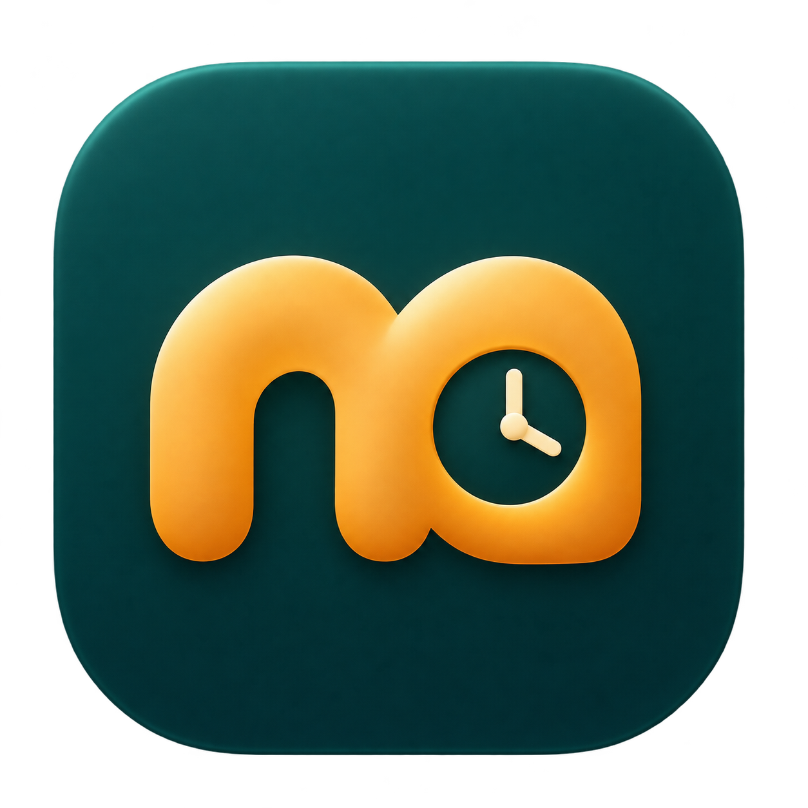

# Second Brain Ecosystem

A small Obsidian setup and the tools that make it easier to use. Short priority lists, plain daily logs, and study laps. **Mahdi** is the first tool: a tiny native Mac focus timer that writes your notes into your vault.

This repository shares the reusable setup and source code. It does not contain the author's personal vault, daily logs, client work, chat exports, or session data.

## Start with the vault

1. Clone this repository, then **copy** `vault-template` somewhere outside the checkout and give it your own name.
2. In Obsidian, choose **Open folder as vault** and select that copy.
3. Open `Home.md`. Use the command palette's **Daily notes: Open today's daily note** to create today's page.
4. Add your own daily priorities and yearly goals. No community plugins are required.

Daily files live in `datodine/` and use personal dates such as `26·308` (year + day of year). Obsidian's corresponding format is `YY·DDDD`. The starter vault includes this configuration and a daily template. See [the workflow](docs/workflow.md).

## Install Mahdi on a Mac

Requires **macOS 14 or later** and the **Swift 6 toolchain** (Xcode 16 or later, or compatible Command Line Tools). If developer tools are missing, run `xcode-select --install` first. No package dependencies, accounts, or API keys.

```sh
git clone https://github.com/kawwshall/second-brain-ecosystem.git
cd second-brain-ecosystem
./scripts/build-mahdi.sh
mkdir -p "$HOME/Applications"
cp -R dist/Mahdi.app "$HOME/Applications/"
open "$HOME/Applications/Mahdi.app"
```

Click the widget's play/note button, choose your Obsidian vault, and start a lap. You can also use **Choose vault…** in Mahdi's menu bar. Connect the root of the vault, not its `datodine` folder.

The build script produces a locally ad-hoc-signed app. This first release is source-first; it is not an Apple-notarized downloadable installer. [Mahdi's guide](tools/mahdi/README.md) covers behavior, local data, and limitations.

<p align="center"></p>

## What's here

| Path | Purpose |
| --- | --- |
| `vault-template/` | Clean starter vault: navigation, clubs, daily template, and simple protocol suggestions |
| `tools/mahdi/` | Native SwiftUI/AppKit timer, icon assets, daily-log writer, and tests |
| `scripts/build-mahdi.sh` | Builds and packages `Mahdi.app` with its Dock icon |
| `docs/` | Workflow, architecture, and next improvements |

## Develop and update

```sh
swift run --package-path tools/mahdi MahdiChecks
./scripts/build-mahdi.sh
```

Quit Mahdi before replacing the installed app. After pulling updates, rebuild and replace `Mahdi.app`; its saved vault choice and session stay in Application Support. Copy the starter vault only once so future repository updates cannot overwrite your notes.

See [CONTRIBUTING.md](CONTRIBUTING.md) and [the roadmap](docs/roadmap.md). Code, starter text, and icon assets are provided under the [MIT license](LICENSE). The icon was AI-generated for this project.
